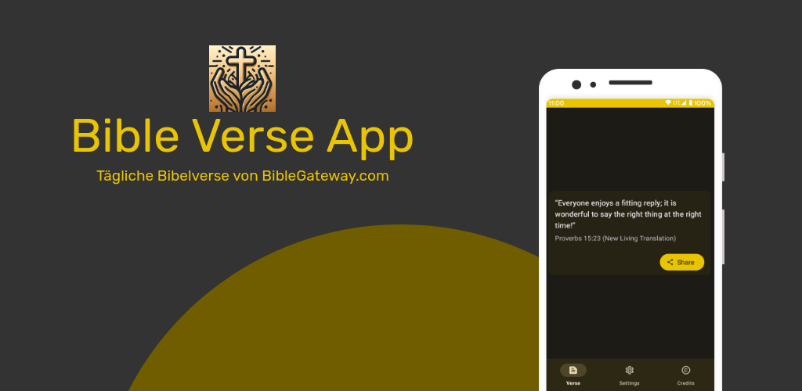
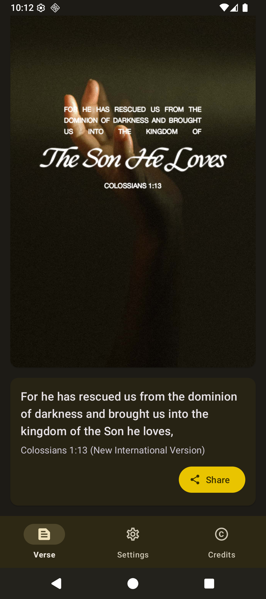
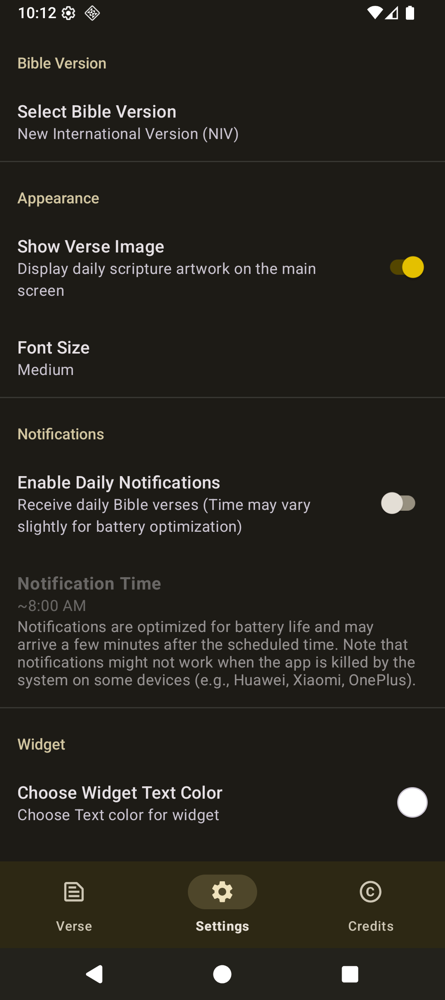
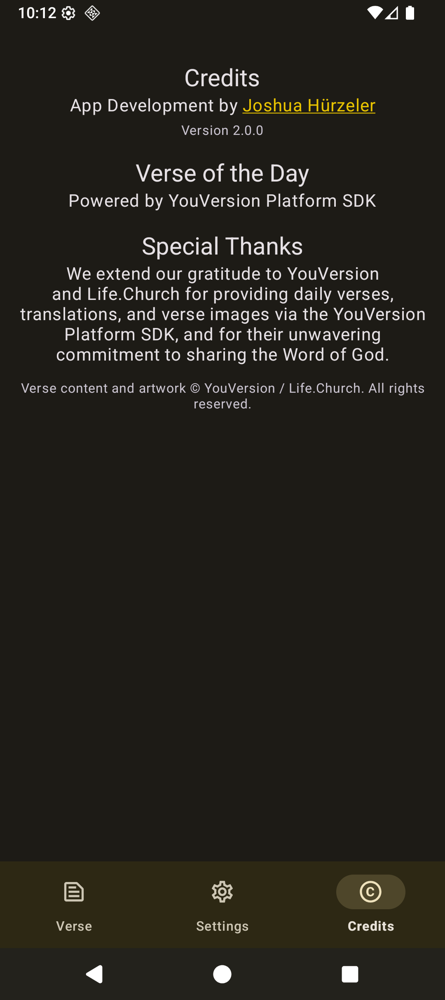
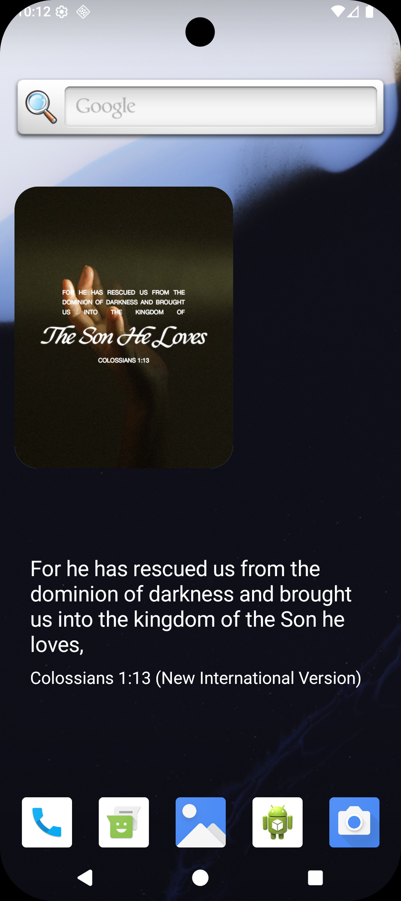
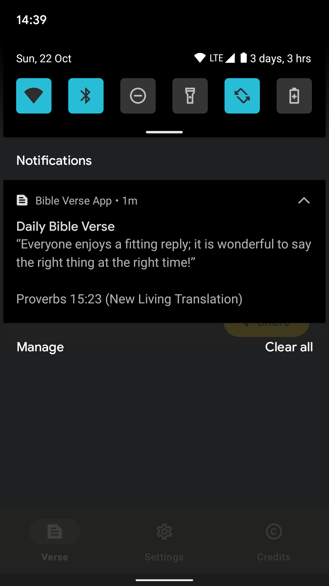

# BibleVerseApp
Die BibleVerseApp bietet täglich inspirierende Bibelverse in verschiedenen Sprachen. 
Mit praktischen Funktionen wie Home-Screen-Widgets (Text-Widget & Vers-Bild-Widget), Benachrichtigungen, dynamischer Übersetzungsauswahl und Vers-Teilen können Sie Ihren Glauben lebendig gestalten und täglich von Gottes Wort inspiriert werden. 

**Powered by YouVersion Platform SDK.**

## Screenshots
| Startseite | Einstellungsseite | Impressumsseite |
|:----------:|:-----------------:|:---------------:|
|  |  |  |

| Widget | Notification |
|:------:|:------------:|
|  |  |

## Features (v2.0)
- **Täglicher Vers des Tages & Vers-Bild Kunstwerk**: Täglicher Bibelvers inklusive hochauflösendem Vers-Bild aus dem YouVersion Platform SDK.
- **Home-Screen-Widgets**:
  - **Text-Widget**: Anpassbare Textfarbe und Schriftgrösse.
  - **Vers-Bild-Widget**: Spezielles Widget zur Anzeige des täglichen Vers-Bild Kunstwerks direkt auf dem Startbildschirm.
- **Dynamische Übersetzungsauswahl**: Auswahl aus verschiedenen Sprachen und YouVersion-Bibelübersetzungen.
- **Tägliche Benachrichtigungen**: Konfigurierbare tägliche Erinnerung mit dem aktuellen Vers des Tages.

## Danksagung & Attribution / Credits
Die Bibelverse, Übersetzungen und Vers-Bilder werden über das **YouVersion Platform SDK** bereitgestellt. Wir danken YouVersion und Life.Church herzlich für die Bereitstellung dieser Inhalte.

## Wie hat das Projekt die erforderlichen Punktzahl fürs Testat erreicht?
| Feature                                               | Bewertung      | Verwendet? | Wie?                                                 |
|-------------------------------------------------------|----------------|------------|------------------------------------------------------|
| Verwendung von Kotlin statt Java (pro Teammitglied)   | 3 Punkte       |     ✅     | Kotlin statt Java                                   |
| Funktionalität (pro Funktion / Screen)                | 1 bis 5 Punkte |     ✅     | 3 Screens: Home, Settings, Credits                  |
| Persistenz / Offlinefähigkeit                         | 1 bis 3 Punkte |     ✅     | Room Datenbank, Settings                            |
| Verwendung von Webservices                            | 1 bis 2 Punkte |     ✅     | YouVersion Platform SDK API                         |
| Verwendung von Notifications                          | 1 bis 2 Punkte |     ✅     | Tages Notification mit Bibelvers                    |
| Verwendung von Aktoren oder Sensoren                  | 1 bis 2 Punkte |     ❌     |                                                     |
| Ressourcen: Lokalisierung                             | 1 bis 2 Punkte |     ✅     | Englisch, Deutsch                                   |
| Ressourcen: Unterschiedliche Layouts pro Gerätetyp    | 1 bis 2 Punkte |     ❌     |                                                     |
| Ressourcen: Unterschiedliche Styles (z.B. Dark-Theme) | 1 bis 2 Punkte |     ✅     | Dark-Theme                                          |
| Verwendung der 2D- und/oder 3D-APIs                   | 1 bis 3 Punkte |     ❌     |                                                     |
| Verwendung von Services, Broadcast Receivers, etc.    | 1 bis 3 Punkte |     ✅     | AlarmManager für Scheduled Notification             |
| Verwendung von Jetpack-Komponenten (pro Typ)          | 1 bis 3 Punkte |     ✅     | AndroidX Preferences, Room, ViewBinding             |
| Integration von Drittkomponenten (Libraries)          | 1 bis 3 Punkte |     ✅     | YouVersion Platform SDK, ColorPicker, Coil          |
| Erstellung eines App Widgets (Home Screen)            | 1 bis 3 Punkte |     ✅     | Text-Widget & Vers-Bild-Widget für den Home Screen  |
| Unterstützung einer zusätzlichen Plattform            | 3 bis 5 Punkte |     ❌     |                                                     |
| Deine eigenen Ideen                                   | 1 bis N Punkte |     ✅     | Veröffentlichung im PlayStore und auf Fdroid, fastlane cli für Sync Metadaten PlayStore und F-Droid konfiguriert |

Mindestpunktzahl: 14 Punkte
